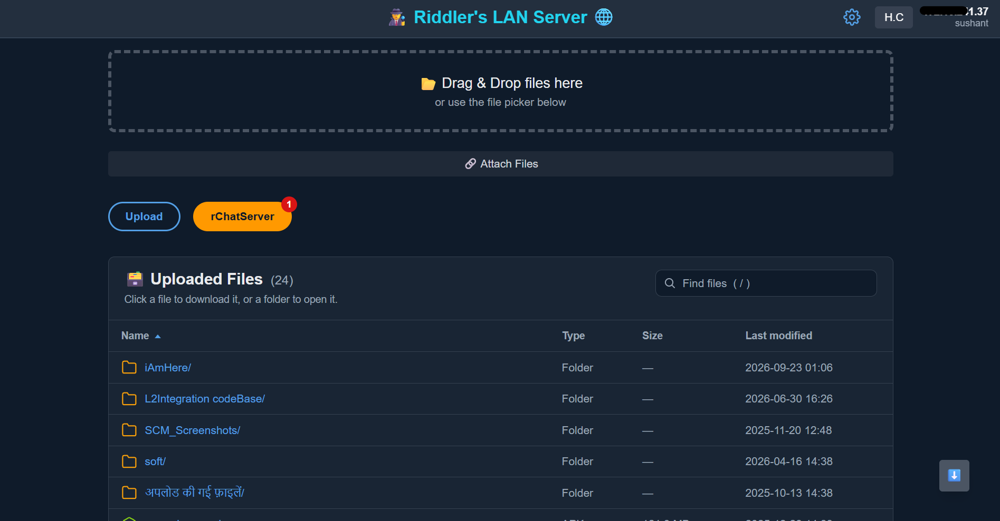
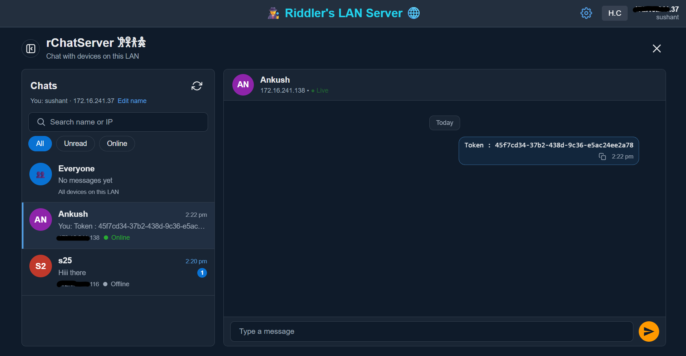

# 🕵️ Riddler's LAN Share

**Share files and chat with every device on your Wi‑Fi / LAN — from a single Python file. No login, no cloud, no app to install on the other devices.**

Run one command on a PC, open `http://<that-pc-ip>:6969/` from any phone, tablet or laptop on the same network, and you can drag‑and‑drop files, download what others uploaded, and chat in real time (public or private).


<!-- Add your screenshots / demo GIF here (see docs/screenshots) -->
<p align="center">
  
  
</p>

## ✨ Features

**📂 File sharing**
- Drag & drop or pick multiple files, with a live upload progress bar (up to 16 GB per request)
- Browse and download files and sub‑folders from any device
- Sortable table (name, type, size, date) with instant **file search** (press `/`)
- Colour‑coded SVG icons per file type (images, PDF, docs, archives, APK, code, video, …)

**💬 rChatServer**
- Real‑time chat over WebSockets — public room plus **private 1‑to‑1 messages**
- Private messages are enforced **on the server** (other devices never receive them)
- Online/offline presence, unread badges, date separators, one‑click **copy** on every message
- Optional display name (default: `noob 241.37`), with your IP shown beneath it

**🎨 UI**
- AWS‑console‑inspired design with **Light / Dark / Browser‑default** modes (⚙ in the header)
- Fully responsive — works on phones as well as desktops

**🪶 Light & offline‑friendly**
- One Python file, two dependencies
- Tailwind and Socket.IO are served locally from `static/vendor/`, so the UI works on networks with no internet or a strict firewall

## 🚀 Quick start

```bash
git clone https://github.com/<your-username>/riddlers-lan-share.git
cd riddlers-lan-share
pip install -r requirements.txt
python newServer.py
```

Then open the address shown by `ipconfig` (Windows) or `hostname -I` (Linux/macOS), for example:

```
http://192.168.1.20:6969/
```

> Every device must be on the **same network**. If a device can't connect, check that your Wi‑Fi doesn't use *client isolation* and that your firewall allows inbound connections on port `6969`.

**Windows shortcut:** create a `.bat` file next to the script:

```bat
@echo off
cd /d "%~dp0"
python newServer.py
pause
```

## ⚙️ Configuration

Edit the constants at the top of `newServer.py`:

| Setting | Default | Meaning |
|---|---|---|
| `UPLOAD_DIR` | a folder on disk | Where uploaded files are stored and served from |
| `port` (last line) | `6969` | Port the server listens on |
| `MAX_CONTENT_LENGTH` | 16 GB | Maximum size of one upload request |
| `MAX_CHAT_HISTORY` | 1000 | Chat messages kept in memory |

## 🧠 How it works

- **Flask** serves the page, file listing/downloads and uploads.
- **Flask‑SocketIO** carries chat, presence and name updates.
- A device is identified by its **IP address** (no accounts). The server joins each socket to a room named after its real IP, so private messages only reach the sender and recipient.
- Chat history lives in memory and is cleared when the server restarts.

## 🗂️ Project structure

```
newServer.py          # the whole app (routes, sockets, HTML/CSS/JS template)
static/vendor/        # tailwind.js, socket.io.min.js (served locally for offline use)
requirements.txt
```

## 🔒 Security notes

This is built for **trusted local networks** (home, office, lab), not the public internet.

- There is no login — anyone who can reach the port can upload and download files.
- Identity is the client IP, so someone who spoofs your IP could read your private messages.
- Don't expose the port to the internet. If you need access control, put it behind a VPN or reverse proxy with authentication.
- Set your own `SECRET_KEY` before sharing a build.

## 🛣️ Roadmap

- [ ] Optional shared PIN / password
- [ ] Folder upload and zip download
- [ ] Delete / rename files
- [ ] Paste a screenshot straight from the clipboard
- [ ] Persistent chat history
- [ ] Standalone `.exe` (no Python needed)

Ideas and PRs are welcome — see below.

## 🤝 Contributing

1. Fork the repo and create a branch: `git checkout -b feature/my-idea`
2. Make your change and test it on two devices
3. Open a pull request describing what and why

## 📄 License

MIT — see [LICENSE](LICENSE).

---

*The visual style is inspired by the AWS console / Cloudscape design language. This project is independent and not affiliated with or endorsed by Amazon Web Services.*

Made with ☕ by **Sushant Kanchan** (aka Riddler)
